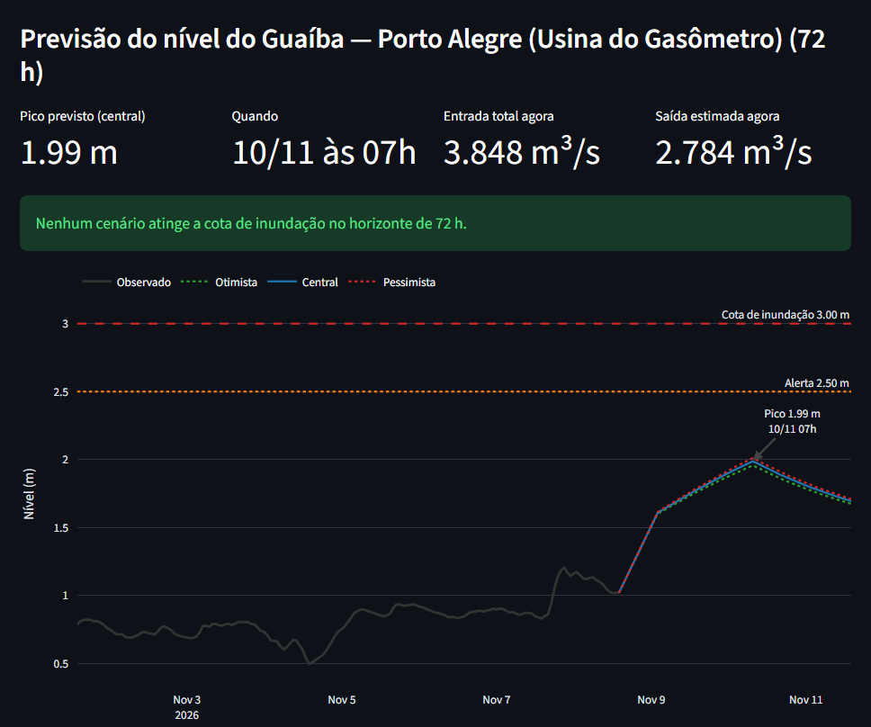

# waters: a mass-balance flood model for the Guaíba (Porto Alegre, Brazil)

In May 2024 the Guaíba reached the highest level ever recorded in Porto Alegre and flooded a large part of the metropolitan region. **waters** is an independent model that answers three questions from live public telemetry:

1. **How much water is entering the Guaíba right now**, and from which river (Jacuí, Taquari, Caí, Sinos, Gravataí)?
2. **How much is leaving** towards the Lagoa dos Patos? No gauge measures this; the model infers it.
3. **What will the level in Porto Alegre be over the next 72 h**, and will it cross the 3.00 m flood stage?

It ships with a Streamlit dashboard, an interactive inundation map, a hindcast validation against the 2024–2025 floods, and four model variants (v1–v4) whose results, good and bad, are documented.



*Live forecast on 08 Nov 2026: observed stage at the Gasômetro gauge (grey) and three crest scenarios for the next 72 h.*


*Interactive inundation map: dragging the gauge level floods land connected to the water body (red, darker = deeper). Shown at 4.25 m, close to the May 2024 peak in this gauge's datum.*

> **This is a personal research project, not an official forecast.** For warnings, follow the Defesa Civil do Rio Grande do Sul.

---

## How it works

```
 ANA telemetry (15 min)                Copernicus DEM GLO-30
 stage + discharge, 14 gauges          30 m surface model
          │                                    │
          ▼                                    ▼
 ┌─────────────────┐   ┌──────────────┐   ┌──────────────────┐
 │ QC + hourly grid│──▶│ Qin(t)       │   │ stage–area A(h)  │
 └─────────────────┘   │ Σ tributaries│   │ inundation raster│
                       │ lag or       │   └────────┬─────────┘
                       │ Muskingum    │            │
                       └──────┬───────┘            │
                              ▼                    ▼
                 A(h)·dh/dt = Qin(t) − Qout(h)   (RK4, 15 min, 72 h)
                              │
          Qout(h) = a·(h − h0)^b, fitted (Huber) to close the
          water balance over the 2024–2026 record
                              │
                              ▼
          peak level + time · 3 scenarios · bias ramp · map
```

1. **Inflow.** The latest discharge at the downstream gauge of each tributary is shifted by a calibrated travel time (v1–v3) or routed with the Muskingum method (v4).
2. **Outflow without a gauge.** Porto Alegre measures only stage. The outflow is written as a power-law rating curve and fitted so that the level-pool water balance closes over two years of data. A robust Huber loss keeps wind set-up and backwater from the Lagoa dos Patos from dominating the fit.
3. **Forecast.** Rivers that are still rising get their crest extrapolated (rise rate decaying exponentially, in three scenarios). The balance is integrated with RK4, and the last 24 h of model error are applied as a ramped bias correction.

The full method, every assumption, and the reference behind each step are in **[docs/METHODOLOGY.md](docs/METHODOLOGY.md)**. Failures, open problems and comparison with the official forecasts are in **[docs/DISCUSSION.md](docs/DISCUSSION.md)**. Data sources and their quirks are in **[docs/DATA.md](docs/DATA.md)**. The papers themselves are in **[papers/](papers/)**.

## Results

**Hindcast** (blind forecast cut 48 h before each observed peak, v1 operational model):

| Event | Observed peak | Forecast peak | Error |
|---|---|---|---|
| May 2024 | 4.14 m (06/05 20h) | 3.81 m (06/05 04h) | −0.33 m / −16 h |
| Jun 2024 | 2.37 m (28/06 23h) | 2.93 m (29/06 23h) | +0.56 m / +24 h |
| Jun 2025 | 2.27 m (25/06 15h) | 2.81 m (26/06 15h) | +0.54 m / +24 h |

**Model comparison**, May 2024, mean absolute error over the whole rising limb:

| Model | Storage | Inflow | Level error | Timing error |
|---|---|---|---|---|
| **v1** (operational) | constant 470 km² | fixed lag | **0.39 m** | 26 h |
| v3 | A(h) from DEM | fixed lag | 0.59 m | **20 h** |
| v4 | A(h) from DEM | Muskingum routing | 0.86 m | 39 h |

v2 used a hand-guessed A(h) curve. It was compared only in an earlier A/B run with slightly different calibration data, where it was also worse than v1 (0.50 m vs 0.34 m level error).

Things I learned along the way:

- **A better stage–area curve did not improve the peak level.** At the peak dh/dt = 0, so A(h) drops out of the balance and the peak is set by Qin = Qout(h). Because Qout is re-fitted for each area assumption, area and outflow trade off: without an independent discharge measurement in Porto Alegre they are not separately identifiable. The DEM curve only helps timing.
- **Muskingum routing works at the reach level but hurts end to end.** It reproduces the Taquari flood wave well (Muçum → Encantado NSE 0.88, Encantado → Lajeado NSE 0.81). Routing only the upstream gauge, however, drops the lateral inflow between that gauge and the river mouth, and the rating curve absorbs the deficit. On the Jacuí, dams (UHE Dona Francisca) break simple channel routing (NSE 0.30–0.49).
- **Closing the water balance is not enough to get the outflow right.** Three ADCP measurements on the Guaíba (UFRGS, 2024–2025) show that the fitted outflow curve gives only about **half** the real discharge at flood stages. The balance still closed during calibration because the inflow was underestimated by a similar amount (gauge gaps, ungauged area). The two errors cancel in the hindcast and separate in a live flood.
- **The peak forecast is volatile while rivers are still rising, and it overshoots.** The model was used live during the July 2026 Taquari flood. Two to three days ahead, every version predicted 4.4–5.0 m at the Cais Mauá gauge; the real peak was 2.15 m. The forecasts converged only once the upstream crest had passed. The official SGB/IPH forecasts overshot too (2.50–2.70 m, after earlier scenarios above 3 m), but by much less. The comparison, the problems the IPH itself reported (damaged gauges, extrapolated rating curves, 1960s bathymetry) and the next steps are in **[docs/DISCUSSION.md](docs/DISCUSSION.md)**.

## Quick start

Python 3.12+.

```bash
python -m venv .venv
source .venv/bin/activate          # Windows: .venv\Scripts\activate
pip install -e ".[dev]"            # add ",geo" for the DEM scripts (rasterio)

python scripts/backfill.py --start 2024-04-01     # download telemetry history
python scripts/calibrate.py                       # fit v1 → config/params/
streamlit run src/waters/dashboard/app.py         # dashboard
```

Other variants: `calibrate.py --area-curve --version v3` and `calibrate.py --routing --area-curve --version v4`. Inundation map: `scripts/build_inundation.py` (needs `.[geo]`).

Tests: `pytest --cov=waters --cov-fail-under=80` (74 tests, 81 % coverage).

## Repository layout

```
config/          stations, routing network, stage–area curve, calibrated params (v1 + experimental v2–v4)
src/waters/
  ingest/        ANA XML client + parser, fallback feed, parquet cache
  model/         preprocessing/QC, lags, rating, storage, inflow, routing, crest, balance (RK4), forecast, inundation
  calibrate/     event detection, lag/crest/routing fits, hindcast, CLI
  dashboard/     Streamlit app and components
scripts/         backfill, calibrate, build_area_curve, build_inundation, replay_event
tests/           unit tests with synthetic fixtures and a real ANA XML sample
docs/            METHODOLOGY.md, DATA.md, DISCUSSION.md, results/, images
papers/          references (open-access PDFs + bibliography)
```

## Limitations

- It propagates only water already observed in the rivers, with no rainfall forecast, so the useful horizon is about 48–72 h.
- Wind set-up and backwater from the Lagoa dos Patos are not modelled. They can add tens of centimetres in Porto Alegre and end up in the rating residuals and the bias correction.
- Inflow is underestimated whenever Rio Pardo (Jacuí) or Lajeado (Taquari) stop reporting discharge, which happens often (see [DATA.md](docs/DATA.md#data-quirks-that-shape-the-model)).
- The inundation map is a static "bathtub" on a surface model (DSM), so it underestimates urban flooding and ignores the river's slope.

## Resumo em português

Modelo hidrológico do Guaíba feito a partir da telemetria aberta da ANA. Ele estima quanta água entra no Guaíba por rio, quanta sai para a Lagoa dos Patos (por balanço de massa, porque não há medição de vazão em Porto Alegre) e prevê o nível no Gasômetro para as próximas 72 h. Tem dashboard, mapa de inundação interativo e validação contra as cheias de 2024 e 2025. A metodologia completa, com as referências, está em [docs/METHODOLOGY.md](docs/METHODOLOGY.md). **Projeto pessoal: não substitui os avisos da Defesa Civil.**

## License

Code: [MIT](LICENSE). Third-party papers in `papers/` keep their own licenses. Data belongs to its providers (see [DATA.md](docs/DATA.md)).
