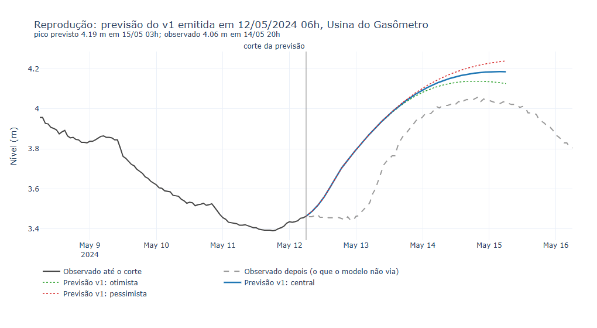
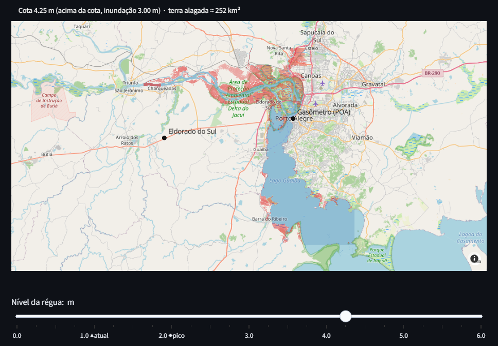

<h1 align="center">Previsão de cheias do Guaíba</h1>

<p align="center">Nível do Guaíba em Porto Alegre nas próximas 72 h, a partir da telemetria pública da ANA.<br>
<em>Guaíba flood forecast for Porto Alegre, from public ANA telemetry.</em></p>

<p align="center"><a href="#português">Português</a> · <a href="#english">English</a></p>

<p align="center">
  
  <a href="LICENSE"></a>
  <a href="https://github.com/wednesdayer/previsao-cheias-guaiba/stargazers"></a>
  
  
</p>

<p align="center">
  
  
  
  
  
  
  
</p>



*Previsão do v1 refeita como se fosse emitida às 6h de 12/05/2024, só com os dados disponíveis naquele instante: 4,19 m para a madrugada de 15/05, contra 4,06 m observados no Gasômetro às 20h de 14/05, no segundo pico da cheia de 2024. A subida prevista começa cerca de um dia antes da real. É o melhor caso das reproduções, dentro da amostra de calibração; os erros médios e os piores casos estão na [discussão, §2](docs/DISCUSSAO.md#2-reprodução-das-quatro-versões-em-2024-e-2026). · v1 forecast replayed as if issued at 06:00 on 12 May 2024, using only data available then: 4.19 m for early 15 May, against 4.06 m observed at the Gasômetro gauge at 20:00 on 14 May, the second peak of the 2024 flood. The forecast rise starts about a day early. This is the best case among the replays, and it falls inside the calibration sample; average and worst errors are in the discussion, §2.*



*Mapa de inundação interativo em 4,25 m, perto do pico de maio/2024 no datum desta régua: em vermelho, a terra alagada conectada ao corpo d'água; tom mais forte indica lâmina mais funda. · Interactive inundation map at 4.25 m, close to the May 2024 peak in this gauge's datum: land connected to the water body that floods (red, darker = deeper).*

---

## Português

Em maio de 2024 o Guaíba atingiu o maior nível já registrado em Porto Alegre e inundou boa parte da região metropolitana. Este projeto (pacote Python `waters`) é um modelo independente que responde a três perguntas usando telemetria pública ao vivo:

1. **Quanta água está entrando no Guaíba agora**, e por qual rio (Jacuí, Taquari, Caí, Sinos, Gravataí)?
2. **Quanta água está saindo** para a Lagoa dos Patos? Nenhuma estação mede isso; o modelo infere.
3. **Qual será o nível em Porto Alegre nas próximas 72 h**, e ele vai passar da cota de inundação de 3,00 m?

O repositório inclui um dashboard em Streamlit, um mapa de inundação interativo, validação por hindcast contra as cheias de 2024–2025 e quatro versões do modelo (v1–v4), com os resultados bons e ruins documentados.

> **Projeto pessoal de pesquisa, não é previsão oficial.** Para avisos, siga a Defesa Civil do Rio Grande do Sul.

### Como funciona

```
 Telemetria ANA (15 min)                 DEM Copernicus GLO-30
 nível + vazão, 14 estações              modelo de superfície de 30 m
          │                                        │
          ▼                                        ▼
 ┌─────────────────────┐   ┌──────────────┐   ┌───────────────────────┐
 │ QC + grade horária  │──▶│ Qin(t)       │   │ curva cota-área A(h)  │
 └─────────────────────┘   │ Σ afluentes  │   │ raster de inundação   │
                           │ defasagem ou │   └──────────┬────────────┘
                           │ Muskingum    │              │
                           └──────┬───────┘              │
                                  ▼                      ▼
                   A(h)·dh/dt = Qin(t) − Qout(h)   (RK4, 15 min, 72 h)
                                  │
          Qout(h) = a·(h − h0)^b, ajustada (Huber) para fechar o
          balanço hídrico no registro de 2024–2026
                                  │
                                  ▼
          nível e hora do pico · 3 cenários · viés em rampa · mapa
```

1. **Entrada.** A vazão mais recente na última estação de cada afluente é deslocada por um tempo de viagem calibrado (v1–v3) ou roteada pelo método Muskingum (v4).
2. **Saída sem medição.** Porto Alegre só mede nível. A saída é escrita como uma curva de descarga em potência, ajustada para fechar o balanço de reservatório em dois anos de dados. Uma perda robusta de Huber evita que o empilhamento pelo vento e o remanso da Lagoa dos Patos dominem o ajuste.
3. **Previsão.** Rios que ainda estão subindo têm a crista extrapolada (taxa de subida com decaimento exponencial, em três cenários). O balanço é integrado por RK4, e o erro do modelo nas últimas 24 h entra como correção de viés em rampa.

O método completo, cada hipótese e a referência por trás de cada etapa estão em **[docs/METODOLOGIA.md](docs/METODOLOGIA.md)**. As falhas, os problemas em aberto e a comparação com as previsões oficiais estão em **[docs/DISCUSSAO.md](docs/DISCUSSAO.md)**. As fontes de dados e suas peculiaridades estão em **[docs/DADOS.md](docs/DADOS.md)**. O plano da v5, um sistema hidrológico-hidrodinâmico nos moldes do IPH, com chuva, vento e a batimetria das cartas náuticas, está em **[docs/PROXIMOS_PASSOS.md](docs/PROXIMOS_PASSOS.md)**. Os artigos estão em **[papers/](papers/)**.

### Resultados

**Hindcast** (previsão às cegas, cortada 48 h antes de cada pico observado; modelo operacional v1):

| Evento | Pico observado | Pico previsto | Erro |
|---|---|---|---|
| Mai/2024 | 4,14 m (06/05 20h) | 3,81 m (06/05 04h) | −0,33 m / −16 h |
| Jun/2024 | 2,37 m (28/06 23h) | 2,93 m (29/06 23h) | +0,56 m / +24 h |
| Jun/2025 | 2,27 m (25/06 15h) | 2,81 m (26/06 15h) | +0,54 m / +24 h |

**Comparação entre versões** em maio/2024 (erro absoluto médio ao longo de toda a subida):

| Modelo | Armazenamento | Entrada | Erro de nível | Erro de tempo |
|---|---|---|---|---|
| **v1** (operacional) | constante, 470 km² | defasagem fixa | **0,39 m** | 26 h |
| v3 | A(h) do DEM | defasagem fixa | 0,59 m | **20 h** |
| v4 | A(h) do DEM | roteamento Muskingum | 0,86 m | 39 h |

O v2 usava uma curva A(h) estimada à mão. Ele só foi comparado num A/B anterior, com dados de calibração um pouco diferentes, e também foi pior que o v1 (0,50 m contra 0,34 m de erro de nível).

O que aprendi no caminho:

- **Uma curva cota-área melhor não melhorou o nível do pico.** No pico, dh/dt = 0, então A(h) sai do balanço e o pico fica definido por Qin = Qout(h). Como a saída é reajustada para cada hipótese de área, área e saída se compensam: sem uma medição independente de vazão em Porto Alegre, elas não são identificáveis separadamente. A curva do DEM só melhora o tempo.
- **O roteamento Muskingum funciona por trecho, mas piora o conjunto.** Ele reproduz bem a onda do Taquari (Muçum → Encantado, NSE 0,88; Encantado → Lajeado, NSE 0,81). Só que rotear apenas a estação de montante perde a contribuição lateral até a foz, e a curva de saída absorve o déficit. No Jacuí, a barragem (UHE Dona Francisca) quebra o roteamento simples (NSE 0,30–0,49).
- **Fechar o balanço não basta para acertar a saída.** Três medições de vazão por ADCP no Guaíba (UFRGS, [2024](https://www.ufrgs.br/iph/wp-content/uploads/2024/07/05_Nota-Vazoes-no-Rio-Guaiba-durante-os-picos-da-enchente-de-maio-de-2024.pdf)–[2025](https://www.ufrgs.br/iph/wp-content/uploads/2025/07/Nota-Tecnica_Cheia-no-Guaiba-.pdf)) mostram que a curva de saída ajustada dá só cerca de **metade** da vazão real em cotas de cheia. O balanço fechou na calibração porque a entrada estava subestimada numa proporção parecida, por lacunas nas estações e área não monitorada. Os dois erros se cancelam no hindcast e se separam numa cheia real.
- **A previsão de pico oscila enquanto os rios sobem, e exagera.** O modelo foi usado ao vivo na cheia do Taquari de julho/2026. Com 2–3 dias de antecedência, todas as versões previram 4,4–5,0 m no Cais Mauá; o pico real foi 2,15 m. As previsões só convergiram depois que a crista de montante passou. As previsões oficiais do SGB/IPH também exageraram (2,50–2,70 m, depois de cenários acima de 3 m), mas bem menos. Reproduzindo as quatro versões a cada 6 h em 2024, julho/2026 e setembro–outubro/2026 (este último depois de todas as calibrações), o erro dobra ou triplica fora da amostra, é sempre para cima, e a faixa entre cenários contém o observado em no máximo 12% das previsões. A comparação, os problemas relatados pelo próprio IPH (estações danificadas, curvas-chave extrapoladas, batimetria dos anos 1960) e os próximos passos estão em **[docs/DISCUSSAO.md](docs/DISCUSSAO.md)**.

### Como rodar

Python 3.12+.

```bash
python -m venv .venv
source .venv/bin/activate          # Windows: .venv\Scripts\activate
pip install -e ".[dev]"            # acrescente ",geo" para os scripts do DEM (rasterio)

python scripts/backfill.py --start 2024-04-01     # baixa o histórico de telemetria
python scripts/calibrate.py                       # ajusta o v1 → config/params/
streamlit run src/waters/dashboard/app.py         # dashboard
```

Outras versões: `calibrate.py --area-curve --version v3` e `calibrate.py --routing --area-curve --version v4`. Mapa de inundação: `scripts/build_inundation.py` (precisa de `.[geo]`). Reprodução de um evento passado: `scripts/replay_event.py`.

Testes: `pytest --cov=waters --cov-fail-under=80` (74 testes, 81% de cobertura).

### Estrutura do repositório

```
config/          estações, rede de roteamento, curva cota-área, parâmetros calibrados (v1 + experimentais v2–v4)
src/waters/
  ingest/        cliente e parser do XML da ANA, fonte reserva, cache em parquet
  model/         pré-processamento/QC, defasagens, curva de saída, armazenamento, entrada, roteamento, crista, balanço (RK4), previsão, inundação
  calibrate/     detecção de eventos, ajustes de defasagem/crista/roteamento, hindcast, CLI
  dashboard/     app Streamlit e componentes
scripts/         backfill, calibrate, build_area_curve, build_inundation, replay_event
tests/           testes unitários com dados sintéticos e uma amostra real do XML da ANA
docs/            METODOLOGIA.md, DADOS.md, DISCUSSAO.md, PROXIMOS_PASSOS.md, resultados/, imagens
papers/          referências (PDFs de acesso aberto + bibliografia + SHA256SUMS)
```

### Limitações

- Só propaga a água já observada nos rios, sem chuva nem vento. Foi uma escolha de partida: ver até onde a água medida pela telemetria basta. A chuva das próprias estações já é baixada e mostra que, em julho de 2026, ela tinha parado horas antes das piores previsões; o erro veio da extrapolação de crista, que presume mais chuva do que houve ([discussão, §3](docs/DISCUSSAO.md#3-a-escolha-de-partir-apenas-da-água-medida-nos-rios)). O horizonte útil é de 48–72 h.
- O empilhamento pelo vento e o remanso da Lagoa dos Patos não são modelados. Podem somar dezenas de centímetros em Porto Alegre e acabam nos resíduos da curva de saída e na correção de viés.
- A entrada fica subestimada sempre que Rio Pardo (Jacuí) ou Lajeado (Taquari) param de transmitir vazão, o que é frequente (ver [DADOS.md](docs/DADOS.md#peculiaridades-dos-dados-que-moldam-o-modelo)).
- O mapa de inundação é uma "banheira" estática sobre um modelo de superfície (DSM): subestima a inundação urbana e ignora a declividade do rio.

### Licença

Código: [MIT](LICENSE). Os artigos de terceiros em `papers/` mantêm as próprias licenças. Os dados pertencem aos seus fornecedores (ver [DADOS.md](docs/DADOS.md)).

---

## English

In May 2024 the Guaíba reached the highest level ever recorded in Porto Alegre, Brazil, and flooded a large part of the metropolitan region. This project (Python package `waters`) is an independent model that answers three questions from live public telemetry:

1. **How much water is entering the Guaíba right now**, and from which river (Jacuí, Taquari, Caí, Sinos, Gravataí)?
2. **How much is leaving** towards the Lagoa dos Patos? No gauge measures this; the model infers it.
3. **What will the level in Porto Alegre be over the next 72 h**, and will it cross the 3.00 m flood stage?

The repository includes a Streamlit dashboard, an interactive inundation map, a hindcast validation against the 2024–2025 floods, and four model variants (v1–v4), with their results, good and bad, documented.

> **This is a personal research project, not an official forecast.** For warnings, follow the Defesa Civil do Rio Grande do Sul.

The detailed documentation is in Portuguese: [methodology](docs/METODOLOGIA.md), [data](docs/DADOS.md), [discussion](docs/DISCUSSAO.md) (with an English summary at the top), [next steps](docs/PROXIMOS_PASSOS.md) and [references](papers/README.md). The next version (v5) is planned as a hydrological-hydrodynamic system along the lines of the IPH/UFRGS one: a rainfall-runoff model for the tributaries, a 1D hydrodynamic model of the Guaíba and the Lagoa dos Patos forced by wind and tide, and the 1960s Navy bathymetry, the only one publicly available.

### How it works

1. **Inflow.** The latest discharge at the downstream gauge of each tributary is shifted by a calibrated travel time (v1–v3) or routed with the Muskingum method (v4).
2. **Outflow without a gauge.** Porto Alegre measures only stage. The outflow is written as a power-law rating curve, fitted so that the level-pool water balance `A(h)·dh/dt = Qin(t) − Qout(h)` closes over two years of data. A robust Huber loss keeps wind set-up and backwater from the Lagoa dos Patos from dominating the fit.
3. **Forecast.** Rivers that are still rising get their crest extrapolated (rise rate decaying exponentially, in three scenarios). The balance is integrated with RK4 on a 15-minute step for 72 h, and the model error over the last 24 h is applied as a ramped bias correction.
4. **Inundation map.** A stage–area curve and a connected-bathtub flood map are derived from the Copernicus GLO-30 DEM.

### Results

**Hindcast** (blind forecast cut 48 h before each observed peak, operational v1):

| Event | Observed peak | Forecast peak | Error |
|---|---|---|---|
| May 2024 | 4.14 m (06/05 20h) | 3.81 m (06/05 04h) | −0.33 m / −16 h |
| Jun 2024 | 2.37 m (28/06 23h) | 2.93 m (29/06 23h) | +0.56 m / +24 h |
| Jun 2025 | 2.27 m (25/06 15h) | 2.81 m (26/06 15h) | +0.54 m / +24 h |

**Model comparison** for May 2024 (mean absolute error over the whole rising limb):

| Model | Storage | Inflow | Level error | Timing error |
|---|---|---|---|---|
| **v1** (operational) | constant 470 km² | fixed lag | **0.39 m** | 26 h |
| v3 | A(h) from DEM | fixed lag | 0.59 m | **20 h** |
| v4 | A(h) from DEM | Muskingum routing | 0.86 m | 39 h |

What I learned along the way:

- **A better stage–area curve did not improve the peak level.** At the peak dh/dt = 0, so A(h) drops out of the balance and the peak is set by Qin = Qout(h). Because Qout is re-fitted for each area assumption, area and outflow trade off: without an independent discharge measurement they are not separately identifiable. The DEM curve only helps timing.
- **Muskingum routing works per reach but hurts end to end.** It reproduces the Taquari flood wave well (NSE 0.81–0.88). Routing only the upstream gauge, however, drops the lateral inflow down to the river mouth, and the rating absorbs the deficit. On the Jacuí, a hydropower dam breaks simple channel routing (NSE 0.30–0.49).
- **Closing the water balance is not enough to get the outflow right.** Three ADCP measurements on the Guaíba (UFRGS, [2024](https://www.ufrgs.br/iph/wp-content/uploads/2024/07/05_Nota-Vazoes-no-Rio-Guaiba-durante-os-picos-da-enchente-de-maio-de-2024.pdf)–[2025](https://www.ufrgs.br/iph/wp-content/uploads/2025/07/Nota-Tecnica_Cheia-no-Guaiba-.pdf)) show that the fitted outflow curve gives only about **half** the real discharge at flood stages. The balance still closed during calibration because inflow was underestimated by a similar amount (gauge gaps, ungauged area). The two errors cancel in the hindcast and separate in a live flood.
- **The peak forecast is volatile while rivers are still rising, and it overshoots.** The model was used live during the July 2026 Taquari flood. Two to three days ahead, every version predicted 4.4–5.0 m at the Cais Mauá gauge; the real peak was 2.15 m. The forecasts converged only once the upstream crest had passed. The official SGB/IPH forecasts overshot too (2.50–2.70 m, after earlier scenarios above 3 m), but by much less. Replaying all four versions every 6 h over 2024, July 2026 and September–October 2026 (the last one after every calibration), the error doubles or triples out of sample, always overshoots, and the scenario band contains the observed maximum in at most 12% of the forecasts.

### Quick start

Python 3.12+.

```bash
python -m venv .venv
source .venv/bin/activate          # Windows: .venv\Scripts\activate
pip install -e ".[dev]"            # add ",geo" for the DEM scripts (rasterio)

python scripts/backfill.py --start 2024-04-01     # download telemetry history
python scripts/calibrate.py                       # fit v1 → config/params/
streamlit run src/waters/dashboard/app.py         # dashboard
```

Other variants: `calibrate.py --area-curve --version v3` and `calibrate.py --routing --area-curve --version v4`. Inundation map: `scripts/build_inundation.py` (needs `.[geo]`). Replaying a past event: `scripts/replay_event.py`.

Tests: `pytest --cov=waters --cov-fail-under=80` (74 tests, 81 % coverage).

### Limitations

- It propagates only water already observed in the rivers, with no rain and no wind. That was a deliberate starting point: see how far the gauged river water alone can go. The rain gauges at the same stations are already downloaded, and in July 2026 they show the rain had stopped hours before the worst forecasts; the error came from the crest extrapolation, which implicitly assumes more rain than fell ([discussion, §3](docs/DISCUSSAO.md#3-a-escolha-de-partir-apenas-da-água-medida-nos-rios), in Portuguese). The useful horizon is about 48–72 h.
- Wind set-up and backwater from the Lagoa dos Patos are not modelled. They can add tens of centimetres in Porto Alegre.
- Inflow is underestimated whenever the Jacuí or Taquari gauges stop reporting discharge, which happens often.
- The inundation map is a static "bathtub" on a surface model (DSM), so it underestimates urban flooding.

### License

Code: [MIT](LICENSE). Third-party papers in `papers/` keep their own licenses. Data belongs to its providers.
